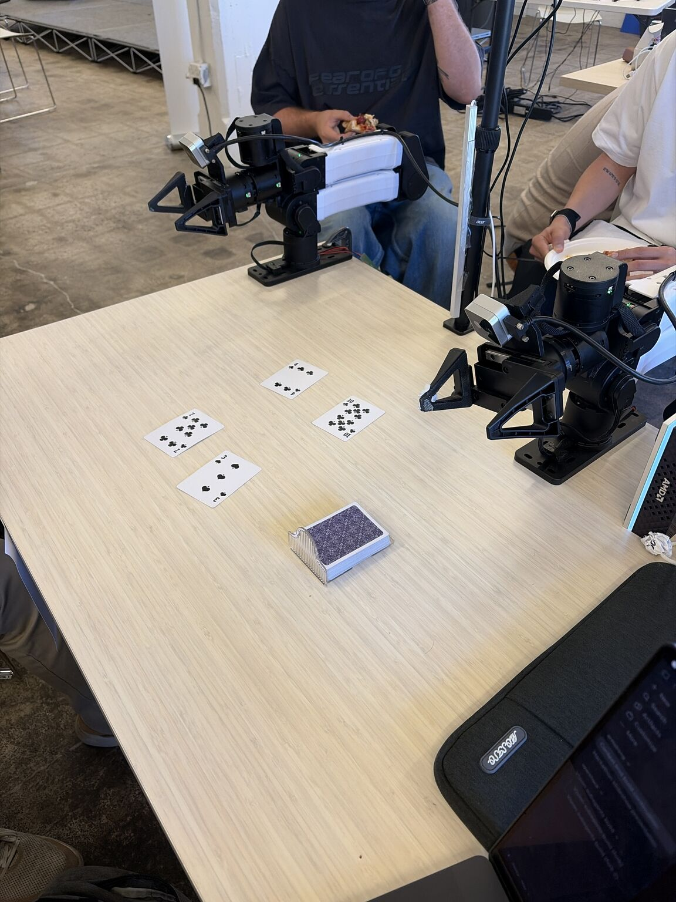
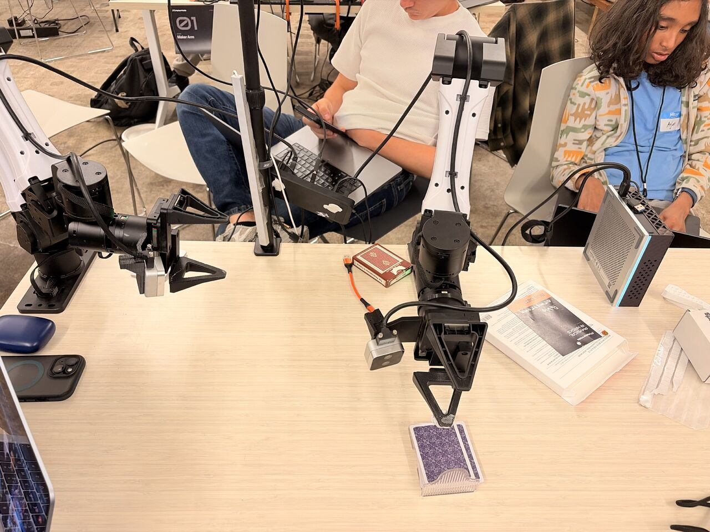
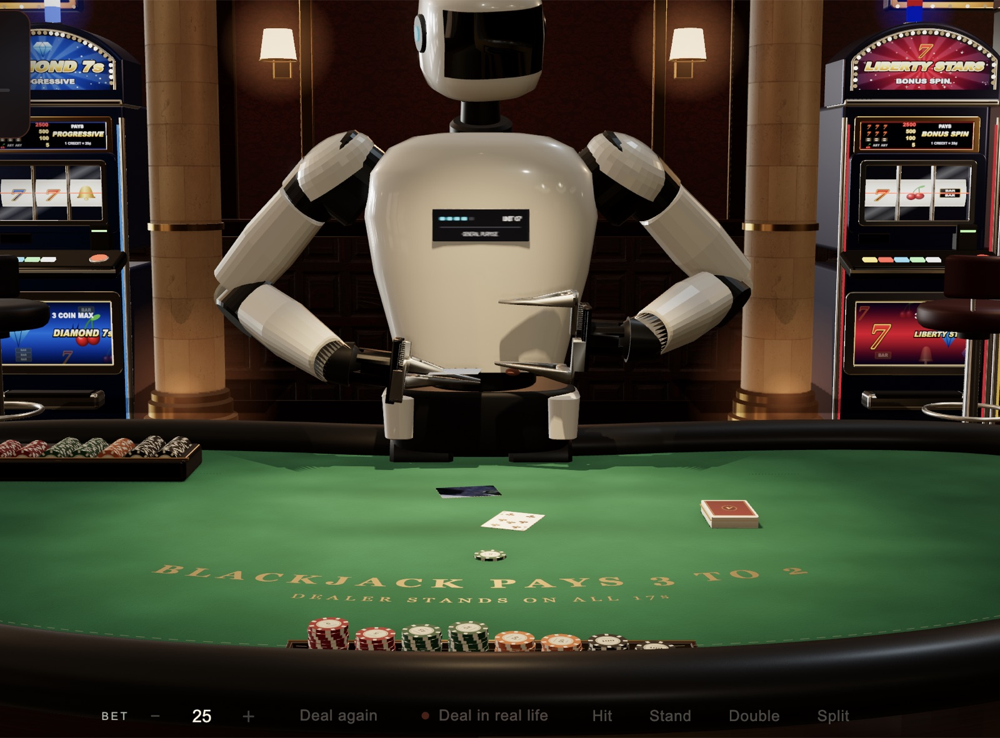
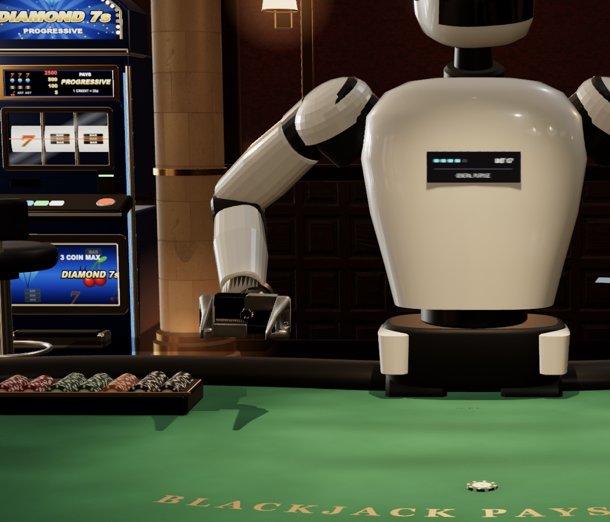

# Ace

**1st place, Creative track, Founders Inc Physical AI Hackathon (November 2026)**

Ace is a robot blackjack dealer that plays with real cards. You talk to it, say "hit" or "stand", and it talks back. Two robot arms pick up the cards and deal them onto the table, and an overhead camera reads each card so the dealer always knows what's in both hands.

Built in two days by Aryan, Pablo, Junsu, Arjun and Rishith.

<p>
  
  
</p>

<p>
  
  
</p>

## How the robot dealer was built

We started with a **one-shot recorded demonstration** of the card cycle. The saved demonstration references and timestamps in DreamLab's `harness/wood-card-cycle/profile.json` became taught arm poses for pickup, handoff, turning, placement, and return. DreamLab's `wood_cycle_plan.py` and `mac_card_program.py` turn those poses into timed joint and Cartesian routes for the two arms. The left arm lifts a card from the deck and hands it to the right arm; the right arm turns it face up and releases it onto the table. See [the real card cycle](docs/real-card-cycle.md) for the sequence, coordinates, and source files.

**LiveKit handles the dealer conversation.** The local voice agent and its demo use LiveKit to connect speech to the blackjack game: a spoken Deal or Hit becomes a game action, and game events become dealer narration. The voice agent calls the game API; the game/controller integration owns any physical deal request. LiveKit itself does not command the arms. See [voice/README.md](voice/README.md) and [voice/DEMO.md](voice/DEMO.md).

**Computer vision checks the table and places cards in the 3D view.** The overhead camera scans the visible space for cards and reads their faces. Local CV tracks card outlines and corners between scans; aligned depth and camera calibration estimate each card's 3D corners, center, orientation, and height. The tabletop updates the rendered cards from those observations as their positions change, while measured arm telemetry drives the arm models. See `card_tracking.py`, `card_pose.py`, and `tabletop/card-pose.js`.

These camera-derived positions are **display estimates**, currently about ±2 cm, and are not robot motion targets. A detected open area or a card's position in the 3D scene does not automatically qualify a physical placement slot. Physical destinations still require a calibrated, controller-approved layout, and live autonomous blackjack remains subject to the integration limits in [TABLETOP.md](TABLETOP.md) and [INTEGRATION.md](INTEGRATION.md).

## Original local app (port 8200)

A standalone local web app, separate from Manifest's interface and process. Uses Python's standard library and the existing `armstrong.blackjack_counting` module. No npm/build step, external fonts, or hosted assets.

Run from `~/armstrong`:

```sh
python3 tools/blackjack/server.py --host 0.0.0.0 --port 8200
```

Open `http://10.103.1.11:8200` on the Halo network, or `http://localhost:8200` on the Halo. Default binding without `--host` is localhost. One shared table per server; browser refresh preserves it. Restarting the server clears the shoe and round. Use only on the trusted local network; there is no account/login layer.

- **Practice:** simulated single-deck rounds, Hit/Stand, automatic dealer, ace handling, natural blackjack and pushes. No motion requests.
- **Physical table:** opening cards alternate player/dealer/player/dealer. Confirm each actual rank and suit, then use Hit/Stand. There is no camera recognition. Confirmation means you checked both the card and its placement. Duplicate physical cards are rejected within a shoe.
- **Counting:** Hi-Lo running/true count and remaining cards. New rounds retain the shoe. Start a fresh shoe only after actually shuffling. All cards are face up in this simplified format; no wagers, split, double or insurance. Dealer stands on all 17.
- **End this round:** available while waiting for a physical card. Confirmed cards remain counted. Account for any unrecorded physical cards before continuing; otherwise shuffle and start a fresh shoe.

## Optional arm connection

The app can read `/v1/card-cycle/status` from `http://127.0.0.1:8100`. Practice and manual confirmation work even if that controller is offline. Arm controls are **disabled by default**, while the separate motion session fixes timing/contact issues.

Once the arm operator has validated motion and free calibrated positions, start this app with `--enable-robot-deals`. Each explicit **Ask arm to deal one card** click sends:

```text
POST /v1/tasks {"prompt":"do the card cycle","execute":true}
GET /v1/tasks/{owned_task_id}
POST /v1/tasks/{owned_task_id}/stop {}
```

No automatic multi-card motion or slot clearing. Only this app's owned task can be stopped. No new task while a deal is pending. Completed, failed or stopped motion still needs human inspection before recording a card. An ambiguous response blocks retry because the request may have started motion; the arm operator must inspect/reconcile the controller before restarting this app. Restarting this app does not stop an arm.

The current three-position row is insufficient for a full opening hand. The motion operator must clear/requalify positions through the existing controller; this app never marks them free or changes calibration. Player/dealer assignment is logical, not a physical placement instruction.

## Validation

```sh
python3 -m unittest discover -s tools/blackjack -p 'test_*.py'
PYTHONPATH=src python3 -m unittest discover -s tests -p 'test_blackjack_counting.py'
node --check tools/blackjack/static/app.js
```

Browser QA covers practice play, a complete manually confirmed physical round, reload, and mobile horizontal overflow. All motion tests use a fake controller. No actual robot commands were sent during validation.

For an independent background process (no shared services restarted):

```sh
systemd-run --user --unit=armstrong-blackjack --collect \
  --property=WorkingDirectory=/home/pablo/armstrong \
  /usr/bin/python3 /home/pablo/armstrong/tools/blackjack/server.py --host 0.0.0.0 --port 8200
```

Logs: `journalctl --user -u armstrong-blackjack`. This transient service does not auto-start at boot. Stop only the web app with `systemctl --user stop armstrong-blackjack`.

## Automatic robot play and 3D reveal (staged update)

The updated version is staged separately on port **8201**, preserving the existing table process on 8200. Motion remains disabled pending the motion session's controller handoff and full-hand layout qualification. It is **not yet a validated, fully autonomous physical blackjack game**.

With `--enable-robot-deals`, the table starts in physical mode. Deal opens a four-card queue; Hit requests a player card; Stand runs the dealer's S17 policy. `robot_play.py` executes one physical card at a time, captures fresh baseline images before each request, waits for the owned task, and calls `vision.CardReader` before updating the count. A failed/ambiguous motion or camera result pauses the queue. Continue retries observation of a completed card without dealing it again. Stop cancels continuation and stops only the owned active task. No slot release, calibration change or automatic stacking is implemented.

Recognition uses fresh top/left/right frames and the existing **tool-free Codex visual planner**. This is model-based recognition, not local GPU inference. The adapter requires one newly placed, readable, face-up card with visible table support; uncertainty does not update the count. Real saved-camera checks read A♦ in 9.2 seconds and rejected an occluded view. No live physical game has been tested yet.

The reveal renders the actual recorded/detected rank and suit with perspective, card edges, lighting, shadows and correct numeric pip counts. Practice draws are labeled virtual. The user's Mac-local reference screenshot was inaccessible; exact visual matching awaits an uploaded reference.

Current physical blocker: only three row positions are qualified, and the separate motion session is recovering a drop-off timeout. A fourth opening card plus hits requires additional qualified destinations or an explicitly accepted operator-clearing flow. Never treat this UI's hand assignment as a robot destination command.

Validation: 35 table/runner/vision tests, 15 counting tests, browser rendering and matching of the 3D reveal to the actual draw. Camera recognition tests used saved photographs; no arm motion was issued by this session.

## Latest practice-first tabletop

The new black 3D tabletop runs separately at **http://10.103.1.11:8202**. See [TABLETOP.md](TABLETOP.md) for full rules, actual YAM model provenance, measured-pose verification, safety coordination and explicit live-play blockers. Its server has no motion endpoint or movement-enable flag. Earlier ports remain available with their original in-memory sessions.
